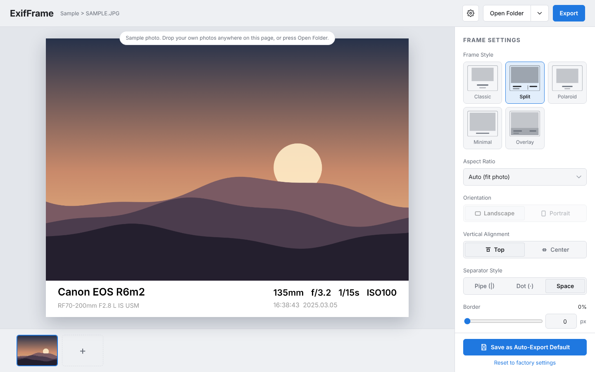

# ExifFrame

เว็บแอปใส่กรอบพร้อมข้อมูล EXIF (กล้อง เลนส์ ทางยาวโฟกัส รูรับแสง ชัตเตอร์ ISO วันที่ถ่าย) ให้รูปถ่ายของคุณ
อ่านค่า metadata จากไฟล์อัตโนมัติ เลือกแบบกรอบ สี ฟอนต์ ขนาดตัวอักษรได้ บันทึกเป็น template และ export ได้ทีละหลายรูป

ทำงานในเบราว์เซอร์ทั้งหมด **รูปไม่ถูกอัปโหลดไปที่ไหน** ทุกอย่างประมวลผลในเครื่องของคุณ



*A browser-based tool that adds an EXIF info frame to your photos. Everything runs locally, no upload. English summary at the bottom.*

## ฟีเจอร์

- **อ่าน EXIF อัตโนมัติ** ยี่ห้อ/รุ่นกล้อง เลนส์ ทางยาวโฟกัส รูรับแสง ชัตเตอร์ ISO และวันเวลาที่ถ่าย
  แก้ค่าแต่ละช่องเองได้ ซ่อนหรือแสดงรายช่องได้ และกดคืนค่าจาก EXIF ได้
- **กรอบ 5 แบบ** Classic, Split, Polaroid, Minimal, Overlay
- **ปรับแต่งกรอบ**
  - อัตราส่วน (Default, Auto, 1:1, 5:4, 4:3, 3:2, 16:9) แนวนอน/แนวตั้ง จัดชิดบนหรือกึ่งกลาง
  - ความหนาขอบและความสูงแถบข้อมูล ทั้งแบบสไลเดอร์และพิมพ์เป็นพิกเซล
  - ตัวคั่น Pipe, Dot, Space และเส้นคั่นกลาง (สไตล์ Split)
- **สีกรอบ สีตัวอักษร** เลือกเองหรือใช้ชุดสีสำเร็จรูป
- **ฟอนต์** Inter, Montserrat, Oswald, Playfair Display, Space Mono, Georgia, Courier New, Noto Sans Thai และ Arial
- **ขนาดตัวอักษรแยกส่วน** Camera, Lens, Specs, Date & Note ปรับแยกกัน พิมพ์เป็นพิกเซลได้
- **รูปแบบวันที่** 6 แบบ
- **โหมด Digital / Film** โหมด Film ใส่ชื่อฟิล์มและ ISO ตามกล่องเอง
- **Template** ตั้งชื่อและบันทึกการตั้งค่ากรอบ เรียกใช้ ลบ ส่งออกและนำเข้าเป็นไฟล์ JSON
- **Save as Auto-Export Default** ใช้การตั้งค่าปัจจุบันเป็นค่าเริ่มต้นตอนเปิดครั้งหน้า
- **Export**
  - JPG หรือ PNG เลือกคุณภาพและขนาดด้านยาวได้
  - เก็บ EXIF เดิมไว้ในไฟล์ที่ export (ปิดได้)
  - เลือกโฟลเดอร์แล้วบันทึกลงไปตรงๆ ได้ (Chrome/Edge)
  - มีหลายรูปจะขึ้นหน้าต่างให้เลือกรูปที่ต้องการก่อน export

## ดาวน์โหลดไปใช้

ไม่ต้องติดตั้งอะไร ไม่ต้องใช้ Node หรือเซิร์ฟเวอร์ โปรเจกต์นี้คือไฟล์ `index.html` ไฟล์เดียว

### วิธีที่ 1 ดาวน์โหลดไฟล์เดียว

1. เปิดไฟล์ [`index.html`](index.html) บน GitHub
2. กดปุ่ม **Download raw file** (ไอคอนดาวน์โหลดมุมขวาบนของกล่องโค้ด)
3. ดับเบิลคลิกไฟล์ที่ดาวน์โหลดมา จะเปิดในเบราว์เซอร์

### วิธีที่ 2 ดาวน์โหลดทั้งโปรเจกต์

1. กดปุ่ม **Code** สีเขียวบนหน้า repo แล้วเลือก **Download ZIP**
2. แตกไฟล์ แล้วเปิด `index.html`

### วิธีที่ 3 ใช้ git

```bash
git clone https://github.com/kulfer/ExifFrame.git
cd ExifFrame
# เปิด index.html ด้วยเบราว์เซอร์
```

### ใช้งานออนไลน์ด้วย GitHub Pages (ไม่บังคับ)

ถ้าอยากเปิดผ่านลิงก์โดยไม่ต้องโหลดไฟล์ ให้ไปที่ **Settings > Pages** ของ repo เลือก Branch `main` โฟลเดอร์ `/ (root)` แล้วกด Save
ลิงก์จะเป็น `https://kulfer.github.io/ExifFrame/`

## วิธีใช้

1. กด **Open Folder** (ในมือถือคือ Open Photos) หรือลากรูปมาวางที่หน้าเว็บ เลือกได้ทั้งโฟลเดอร์และหลายไฟล์พร้อมกัน
2. โปรแกรมอ่านข้อมูล EXIF ของแต่ละรูปให้เอง คลิกรูปย่อด้านล่างเพื่อสลับรูป (ใช้ปุ่มลูกศรซ้าย/ขวาได้)
3. ปรับกรอบทางแผงขวา ผลเห็นทันทีในพรีวิว
4. ถ้าอยากใช้ค่าเดิมซ้ำ ให้ตั้งชื่อใน **Templates** แล้วกด Save
5. กด **Export**
   - ถ้ามีหลายรูป จะขึ้นหน้าต่างให้ติ๊กเลือกรูปก่อน
   - ครั้งแรกเบราว์เซอร์จะให้เลือกโฟลเดอร์ปลายทาง (Chrome/Edge) ไฟล์จะถูกบันทึกลงไปเลย ครั้งต่อไปใช้โฟลเดอร์เดิมโดยไม่ต้องเลือกซ้ำ จนกว่าจะปิดหรือรีเฟรชหน้า
   - เปลี่ยนโฟลเดอร์ได้ที่ไอคอนเฟือง ตรงช่อง Save to folder

ชื่อไฟล์ที่ export คือ `ชื่อเดิม_exifframe.jpg` (หรือ `.png`) ถ้าชื่อซ้ำกับไฟล์เดิมในโฟลเดอร์จะเขียนทับ

## เบราว์เซอร์ที่รองรับ

| ความสามารถ | Chrome / Edge | Firefox / Safari |
| --- | --- | --- |
| ใส่กรอบ พรีวิว และ template | ได้ | ได้ |
| อ่าน EXIF ของ JPEG | ได้ | ได้ |
| เลือกโฟลเดอร์แล้วบันทึกตรง | ได้ | ไม่ได้ (ไฟล์ลงโฟลเดอร์ Downloads) |
| Export หลายรูป | ได้ทีละไฟล์ลงโฟลเดอร์ | รวมเป็นไฟล์ .zip |

ไฟล์รูปที่เปิดได้คือ JPG, PNG, WebP, TIFF ส่วนไฟล์ RAW และ HEIC ยังไม่รองรับ

## ข้อมูลที่เก็บไว้ในเบราว์เซอร์

Template และค่าเริ่มต้นเก็บใน `localStorage` ของเบราว์เซอร์นั้น ถ้าล้างข้อมูลเว็บหรือย้ายเครื่องจะหาย
ให้กด **Export JSON** ในส่วน Templates เพื่อสำรอง แล้วใช้ **Import JSON** นำเข้าในเครื่องใหม่

## รายละเอียดทางเทคนิค

- ไฟล์เดียว HTML + CSS + JavaScript ล้วน ไม่มี build step
- วาดกรอบด้วย Canvas และใช้ขนาดเต็มของรูปต้นฉบับตอน export
- อ่าน EXIF ของ JPEG ด้วยตัวอ่านในตัว ส่วนไฟล์ชนิดอื่นใช้ไลบรารี [exifr](https://github.com/MikeKovarik/exifr) เป็นตัวสำรอง
- เก็บ EXIF เดิมโดยคัดลอกบล็อก EXIF ของต้นฉบับใส่ไฟล์ใหม่ และแก้ค่าที่ต้องเปลี่ยนให้ตรงกับภาพใหม่ คือ ทิศทางภาพ (Orientation) ขนาดภาพ และตัดภาพย่อ (thumbnail) ทิ้ง
- บันทึกลงโฟลเดอร์ด้วย [File System Access API](https://developer.mozilla.org/docs/Web/API/File_System_API) (`showDirectoryPicker`)
- สร้างไฟล์ .zip ในตัวเมื่อบันทึกลงโฟลเดอร์ไม่ได้

### สิ่งที่ต้องใช้อินเทอร์เน็ต

เปิดใช้งานแบบออฟไลน์ได้ แต่จะมีข้อแตกต่างเล็กน้อย
- ฟอนต์ (Inter, Montserrat ฯลฯ) โหลดจาก Google Fonts ถ้าออฟไลน์จะใช้ฟอนต์สำรองของระบบแทน (เช่น Arial)
- ไลบรารี exifr โหลดจาก jsDelivr ใช้เฉพาะรูปที่ไม่ใช่ JPEG ถ้าออฟไลน์จะอ่าน EXIF ของ PNG/TIFF/WebP ไม่ได้ ต้องกรอกค่าเอง

## ข้อจำกัด

- ค่าที่แก้ในช่องของโปรแกรม (เช่น แก้ชื่อเลนส์) จะแสดงบนกรอบเท่านั้น ไม่ถูกเขียนกลับลง EXIF ของไฟล์ที่ export
- โปรไฟล์สีเดิมของรูป (เช่น Adobe RGB) จะไม่ถูกคัดลอก ภาพที่ export เป็น sRGB
- รูปขนาดใหญ่มากอาจ export ไม่ได้ตามหน่วยความจำของเบราว์เซอร์ ให้ลดขนาดด้านยาวในหน้าต่าง Export settings
- Chrome ไม่ให้เลือกโฟลเดอร์ระดับระบบบางที่ เช่น Documents หรือ Downloads โดยตรง ให้สร้างโฟลเดอร์ย่อยแล้วเลือกอันนั้นแทน

## English summary

ExifFrame is a single-file web app (`index.html`) that reads EXIF metadata from your photos and draws it as a frame around each image.

- 5 frame styles, custom frame/text colors, fonts, per-part text sizes, bar height and border (slider or typed pixels)
- Saved templates (stored in `localStorage`, importable/exportable as JSON)
- JPG/PNG export that keeps the original EXIF, batch export with a photo picker, and direct save to a chosen folder (Chromium browsers; other browsers download a .zip)
- No upload, no build step. Download `index.html` and open it in a browser, or serve the repo with GitHub Pages.
